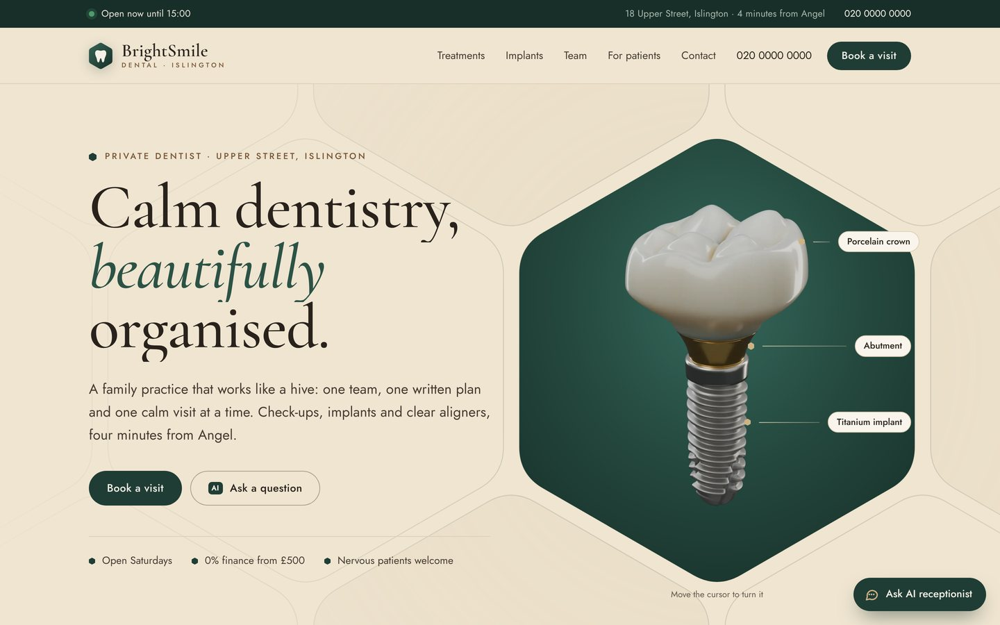
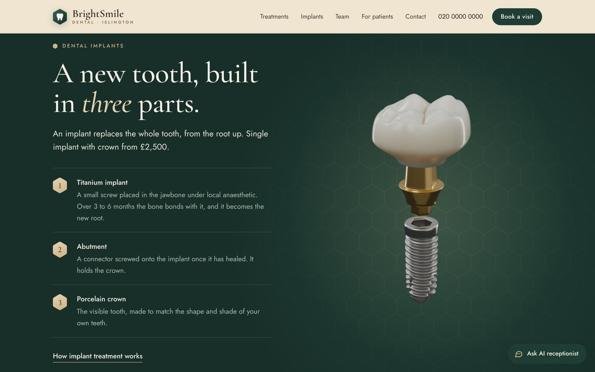
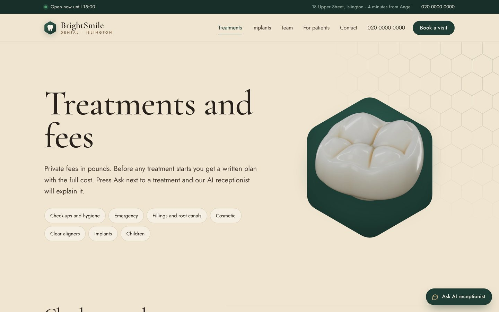
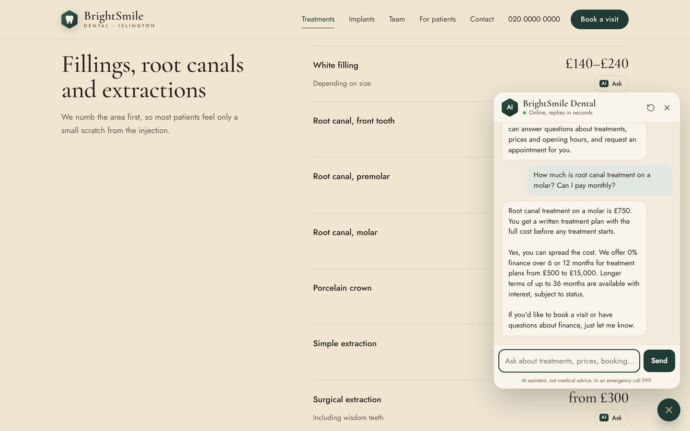
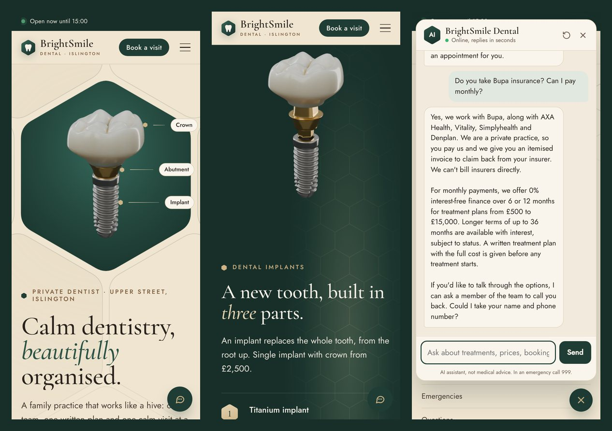

# Dental clinic website with a 3D implant and an AI receptionist

A multi-page clinic website with an interactive 3D dental implant, plus a 24/7 AI receptionist that answers
patients' questions from the clinic's own information and collects appointment requests for the team
(website chat + Telegram, with an admin panel in Telegram).

> Demo project. "BrightSmile Dental" is a fictional clinic; names, prices and contacts are made up.

Demo video: [`ai-dental-receptionist-demo.mp4`](ai-dental-receptionist-demo.mp4) (34 s: the 3D implant, the scroll story
and a real answer from the AI receptionist). Live: https://dental-clinic-production-b8f4.up.railway.app



| Scroll takes the implant apart | Treatments and fees |
|---|---|
|  |  |

| "Ask" next to any treatment opens the AI with that question | Mobile |
|---|---|
|  |  |

## The website

- **Pages:** home, treatments and fees, implants, team, for patients (new patients, finance, aftercare,
  emergencies, questions), book a visit, and a 404 page
- **Photoreal 3D implant**, modelled and rendered in Blender with Python (see [`3d/`](3d/README.md)):
  five-cusp porcelain molar crown with subsurface scattering, gold-coloured abutment, titanium implant with a
  real thread profile. At the top of the home page it turns with the cursor (or a finger); further down, and on the
  implants page, it comes apart as you scroll, next to the step that explains each part
- **Design:** warm cream pages, deep green sections for the 3D and a honeycomb motif (a practice that works like
  a hive); Cormorant Garamond headings, Jost text; smooth scrolling (Lenis). A second, dark design is built in:
  `python site/build.py --theme atelier`
- **Live opening hours:** the top bar shows whether the clinic is open right now and when it opens next
- **AI everywhere it helps:** an "Ask" button next to every fee opens the chat with that question; the
  conversation follows the visitor from page to page; the home page has the chat built in
- **Booking form** sends the same Telegram notification as the AI and appears in the same admin list.
  Spam protection: hidden bot field, timing check, requests per network per hour. Works without JavaScript too
- **Fast:** no frameworks and no WebGL; frames are WebP with transparency (about 30 KB each), loaded
  progressively, a smaller set on phones; the story frames load only when you get near them
- **Accessible:** keyboard navigation, visible focus, reduced-motion support, labelled form fields
- **SEO:** titles and descriptions, Open Graph preview image, schema.org `Dentist` data, `sitemap.xml`,
  `robots.txt`. The demo asks search engines not to index it; set `SITE_NOINDEX=0` for a real clinic
- **One source of truth:** a test checks that every price on the website is in the AI's knowledge base, so the
  receptionist never contradicts the site

## The AI receptionist

**For patients** (website chat and Telegram)
- Answers questions about treatments, prices, opening hours, location, insurance, finance and aftercare
- Uses only the clinic's knowledge base: no invented prices or promises; says so when it doesn't know
- Collects name, phone, reason and preferred time, then sends an **appointment request** to reception
- Offers a **callback** from a real person when it can't help
- Replies in the patient's language
- Safety rules: no diagnosis or medicine advice; red-flag symptoms (swelling near the eye or neck,
  trouble breathing, heavy bleeding) get an immediate "call 999 / go to A&E" reply that doesn't depend on the model

**For the clinic**
- Instant Telegram notification for every request (AI or booking form), with "Contacted" / "Booked" buttons
- `/admin`: conversations, messages, requests, token usage and estimated cost, CSV export
- Update the knowledge base without code: send a `.md`/`.txt` file to the bot or edit the `knowledge/` folder
- Spam-proof costs: hard daily AI budget (then "please call us" without AI calls + Telegram alert),
  per-patient and per-IP daily limits, burst rate limiting, prompt caching of the knowledge base
  (measured: about $0.0001 per message on Claude Haiku 5.5, so 1,000 messages ≈ $0.11)
- The chat also works on any other website with one line:
  `<script src="https://your-server/static/widget.js" data-title="Your Clinic" defer></script>`
  (see `/bubble`; `/demo` shows the chat on its own)

## How it works

```
patient → website chat / Telegram
        → context: the whole knowledge base if it's small (typical clinic),
          otherwise BM25 search over knowledge/*.md (free, offline, instant)
        → LLM (Claude or OpenAI) with the relevant sections + safety rules
        → tool calls: request_appointment / request_callback → saved + staff notified
        → answer
booking form → /api/contact → validated → saved + staff notified
```

- Python, aiohttp, aiogram 3, SQLite; plain HTML/CSS/JS for the site; Blender (Cycles) for the 3D
- Provider-agnostic: Anthropic (Claude) or OpenAI, switch with `LLM_PROVIDER`; `mock` mode works offline
- Native tool calling on both providers, conversation memory per patient
- Automated tests: assistant, both providers' tool-calling loops against fake APIs, pages, booking form, SEO files

```
app/          server: AI assistant, website routes and APIs, Telegram bot
knowledge/    clinic information the AI uses (Markdown)
site/         website sources: pages/*.html + themes/ (layout, home page, logo)  →  python site/build.py  →  webapp/
webapp/       built pages, CSS, JavaScript, rendered frames (seq/), chat widget (widget.js)
3d/           Blender scene in Python + render and conversion scripts
tests/        automated tests
```

## Run

```bash
cp .env.example .env      # add ANTHROPIC_API_KEY (or OPENAI_API_KEY), optional BOT_TOKEN and ADMIN_IDS
bash start.command        # installs dependencies, opens a public link and starts everything
```

Website: `http://localhost:8090` (and the public `trycloudflare.com` link printed at start).
Without an API key the assistant runs in demo mode and answers with the best matching knowledge-base section.

## Tests

```bash
pip install -r requirements-dev.txt
pytest
```

## Customise for another clinic

- Replace the files in `knowledge/` (one `## section` per topic works best)
- Edit the pages in `site/pages/` (the home page is in `site/themes/hive/pages/`), then run `python site/build.py`
- Change `CLINIC_NAME`, `CLINIC_PHONE` in `.env`
- Adjust tone and rules in `app/assistant.py` (`SYSTEM`)
