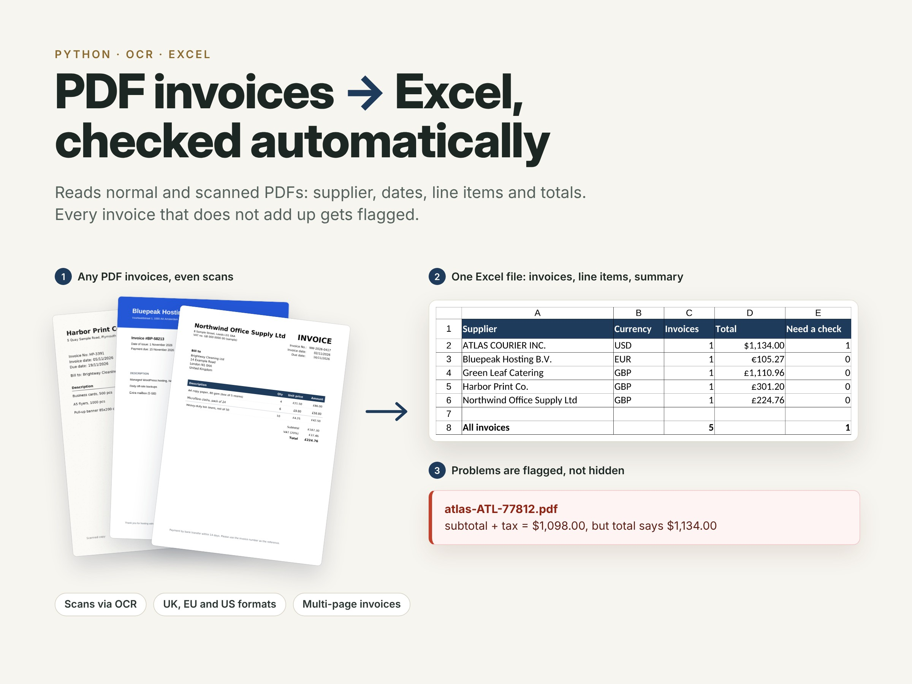
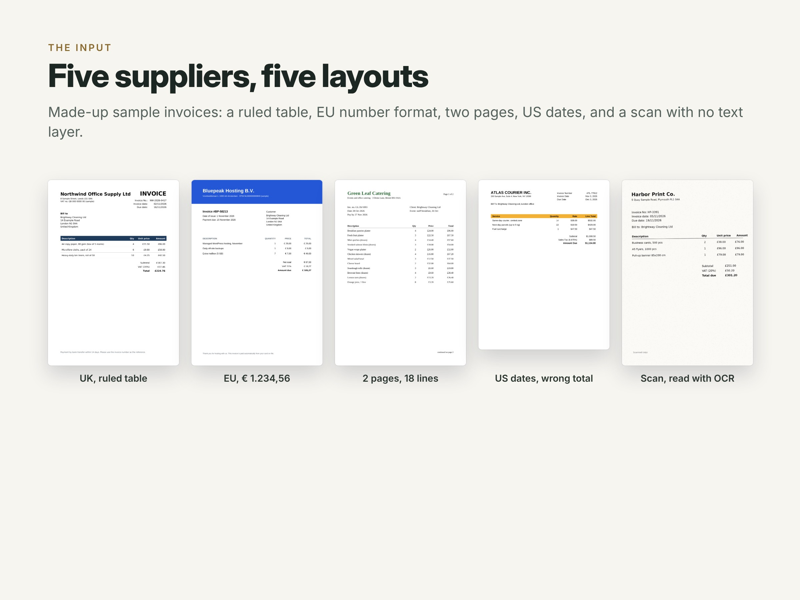
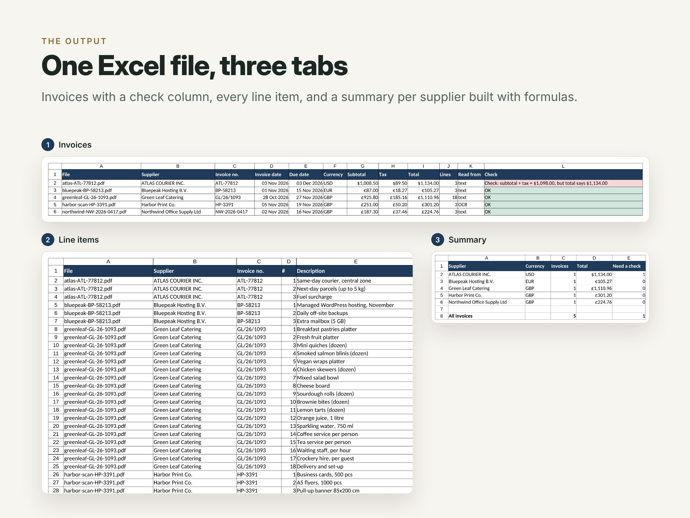

# PDF invoices → Excel, checked automatically

A Python script that reads a folder of invoice PDFs (normal PDFs and scans) and puts everything into one Excel file. It also checks the maths, so a person only looks at the invoices that need it.



## What it does

- Finds the supplier, invoice number, invoice date, due date, currency, line items, subtotal, tax and total.
- Works with different layouts: ruled tables, plain columns, two-page invoices, UK, EU (`€ 1.234,56`) and US formats.
- Reads scans (an image inside the PDF, no text) with OCR (Tesseract), after a small clean-up of scanner dust.
- If OCR misreads a small quantity (for example `1` as `cf`), the quantity is worked out from the price and the amount, and the line gets a note.
- Checks every invoice: quantity × price = amount, the lines add up to the subtotal, subtotal + tax = total, the due date is after the invoice date, nothing important is missing.
- Writes `invoices.xlsx` with three tabs: **Invoices** (one row per invoice, green/red check column), **Line items** (every line) and **Summary** (per supplier, built with formulas). Also two CSV files.

## The demo

`samples/` has five made-up invoices, each with a different layout (the companies are fictional):

| File | What is special |
|---|---|
| `northwind-NW-2026-0417.pdf` | UK invoice, ruled table, a big "INVOICE" heading next to the supplier name |
| `bluepeak-BP-58213.pdf` | EU number format (`€ 105,27`), no table lines |
| `greenleaf-GL-26-1093.pdf` | two pages, 18 lines, the table header repeats on page 2 |
| `atlas-ATL-77812.pdf` | US dates (`Nov 3, 2026`); the printed total is $36 too high on purpose |
| `harbor-scan-HP-3391.pdf` | a scan: image only, read with OCR |

```
$ python extract.py samples/ -o output/invoices.xlsx
!!  atlas-ATL-77812.pdf          ATLAS COURIER INC.           ATL-77812     USD   1,134.00   3 lines  text
      -> subtotal + tax = $1,098.00, but total says $1,134.00
OK  bluepeak-BP-58213.pdf        Bluepeak Hosting B.V.        BP-58213      EUR     105.27   3 lines  text
OK  greenleaf-GL-26-1093.pdf     Green Leaf Catering          GL/26/1093    GBP   1,110.96  18 lines  text
OK  harbor-scan-HP-3391.pdf      Harbor Print Co.             HP-3391       GBP     301.20   3 lines  OCR
OK  northwind-NW-2026-0417.pdf   Northwind Office Supply Ltd  NW-2026-0417  GBP     224.76   3 lines  text

5 invoices, 30 lines -> output/invoices.xlsx
1 need a check
```

The result is in [`output/`](output/): `invoices.xlsx`, `invoices.csv`, `line_items.csv`.




## Run it

```bash
pip install -r requirements.txt   # plus Tesseract for scans: brew install tesseract / apt install tesseract-ocr
python make_samples.py            # creates the sample PDFs (already in samples/)
python extract.py samples/ -o output/invoices.xlsx
python -m pytest                  # 14 tests
```

## For real use

- New supplier layouts usually need only new label words (for example "Rechnungsnummer") in `LABELS`.
- The same data can go to Google Sheets instead of Excel, or the script can watch an email inbox or a Drive folder.
- For messy or very different layouts an AI model can read the fields; the maths checks stay the same, so mistakes still get flagged.
