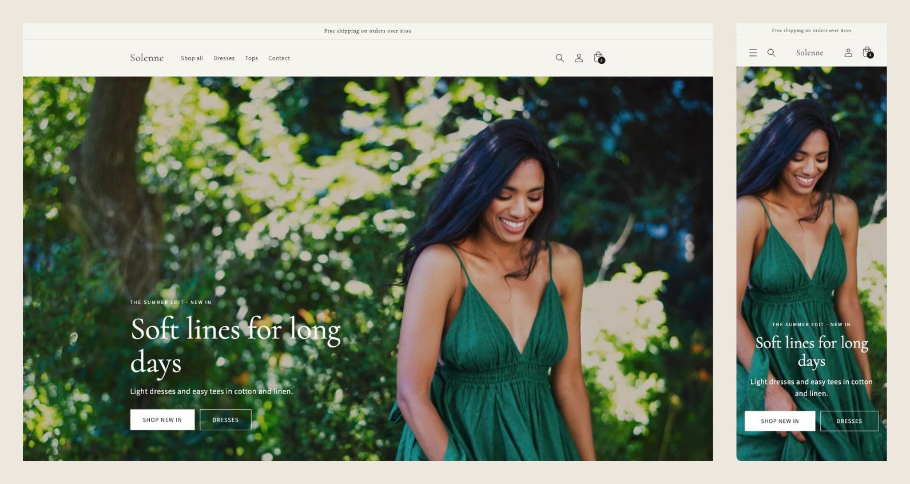
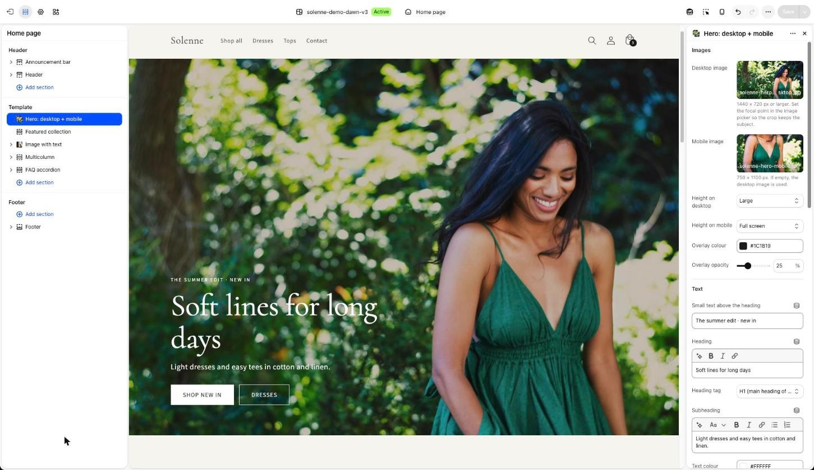
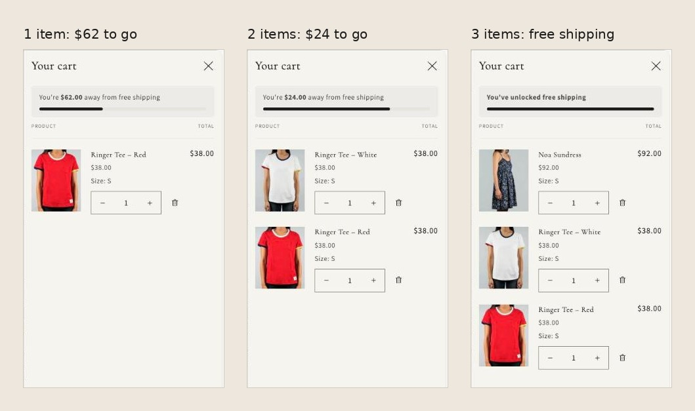
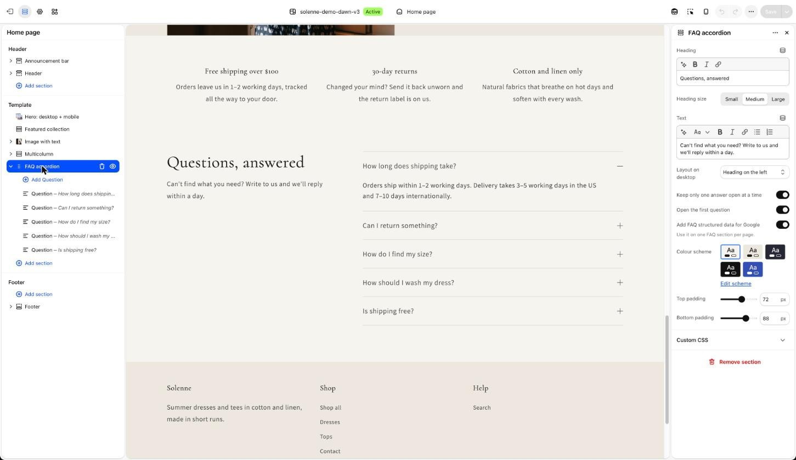
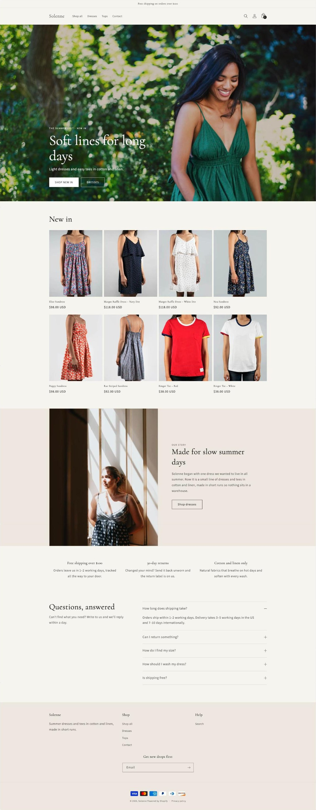
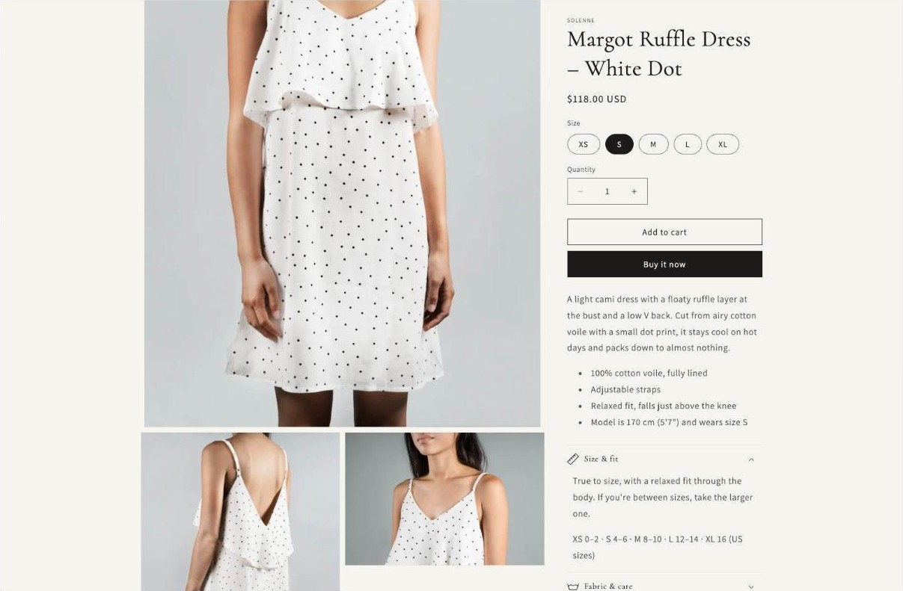

# Shopify sections: hero from a design, free shipping bar, FAQ

Three custom Online Store 2.0 sections for **Solenne**, a fictional summer clothing brand. Built on Shopify's Dawn theme (16.1.1) and tested in a Shopify development store with a full catalog: 8 products with sizes, two collections, menus, product pages and a cart. No apps: just Liquid, CSS and a few lines of JavaScript, and every text, image, colour and position is a setting in the theme editor.

## 1. Hero: separate desktop and mobile images

`sections/hero-media.liquid` + `assets/section-hero-media.css`

- Different images for desktop and mobile (a real `<picture>` with a mobile `<source>`), each with its own focal point from the image picker.
- The first hero on a page is not lazy-loaded and gets `fetchpriority="high"`, with `srcset` widths from 375 to 3840 px, so it loads fast and does not jump.
- Height: adapt to the image, small, medium, large or full screen. Full screen starts under the announcement bar and the header, so the buttons are visible on load on a phone.
- 9 text positions on desktop, top / middle / bottom on mobile, separate text alignment for each.
- Heading, small text above it, subheading, two buttons (solid, outline or text link), overlay colour and opacity, button colours and corner radius.
- Typography settings to match a Figma file: heading size for desktop and mobile, letter spacing, subheading size, optional font for the heading, H1 or H2.

## 2. Free shipping progress bar in the cart

`snippets/free-shipping-bar.liquid` + `assets/component-free-shipping-bar.css`

- Shows "You're $62.00 away from free shipping" with a progress bar in the cart drawer and on the cart page, then "You've unlocked free shipping".
- It sits inside the parts of the cart that Dawn re-renders after every change, so it updates instantly without extra JavaScript.
- Theme settings → Free shipping bar: on/off, the goal, both messages (`[amount]` is replaced with the amount left), bar and track colours.

## 3. FAQ accordion

`sections/faq-accordion.liquid` + `assets/section-faq-accordion.css`

- Native `
`: works without JavaScript and with the keyboard.
- "Keep only one answer open at a time" uses the `name` attribute of `
`, no script needed.
- Optional FAQPage structured data (JSON-LD) for Google, built from the same questions.
- Heading on the left or above the questions, open the first question, colour scheme, padding. In the theme editor each block is listed by its question.

## The store around the sections

The demo store is password-protected, so here is the whole home page and a product page. The product page uses Dawn's own blocks with size, fabric and shipping tabs.

## Install in Dawn (or another Online Store 2.0 theme)

1. Copy `sections/`, `snippets/` and `assets/` into the theme.
2. Add the settings group from `install/settings_schema-free-shipping-bar.json` to the end of `config/settings_schema.json`.
3. Render the bar where the cart is re-rendered:
   - `snippets/cart-drawer.liquid`, right before `<cart-drawer-items`:
     `

`
   - `sections/main-cart-footer.liquid`, first line inside the subtotal block's `
`:
     ``
4. Customize → Add section → "Hero: desktop + mobile" and "FAQ accordion".

`install/index.example.json` is the home page of the demo store.

## Checked

- Shopify Theme Check: 0 issues in these files.
- Tested in a Shopify development store: desktop and mobile preview, cart drawer and cart page, adding items and changing quantities below and above the free shipping goal.

Photos are from Shopify's free image library (Burst). Solenne and its products are made up for this demo. Dawn itself is Shopify's theme and is not included here.
