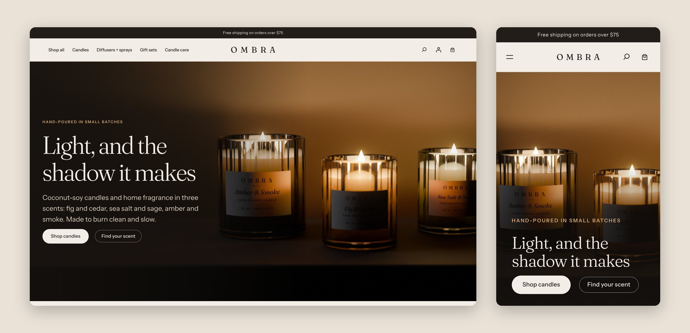
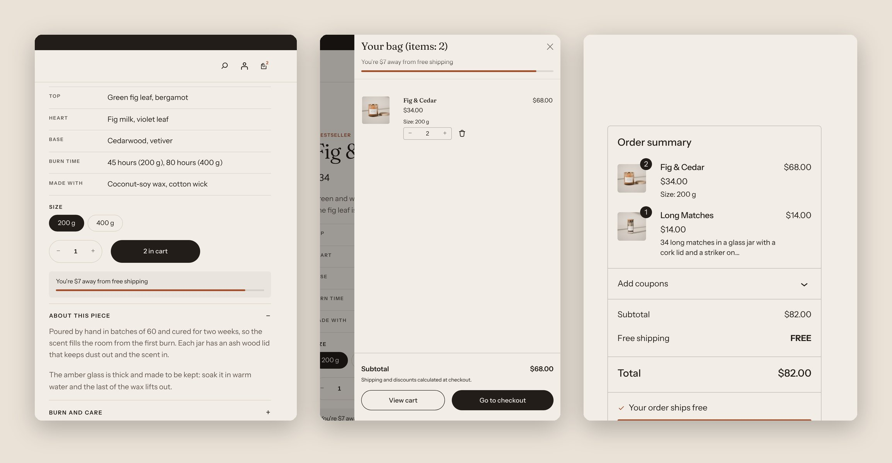
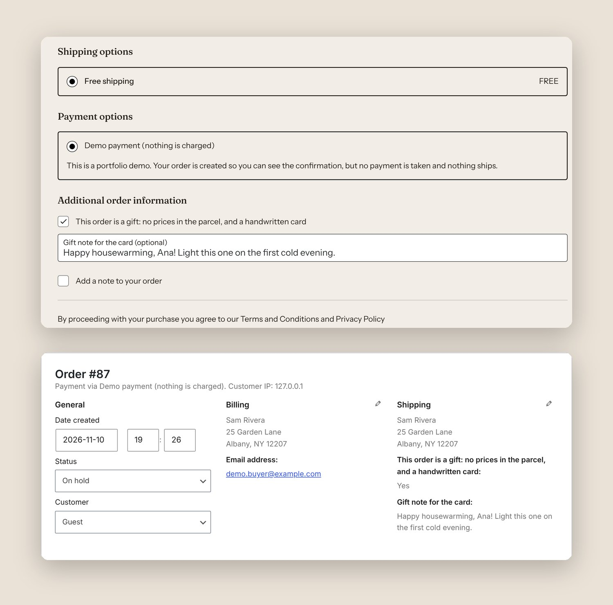
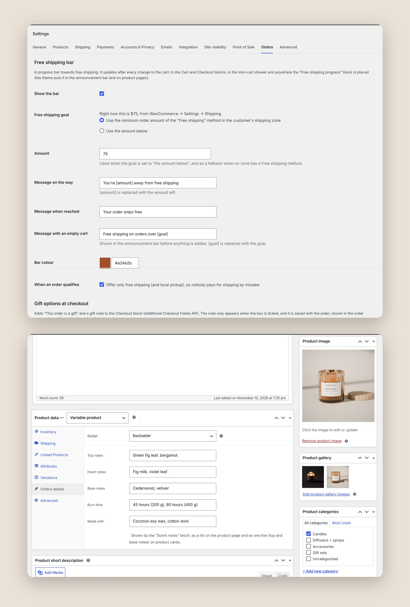
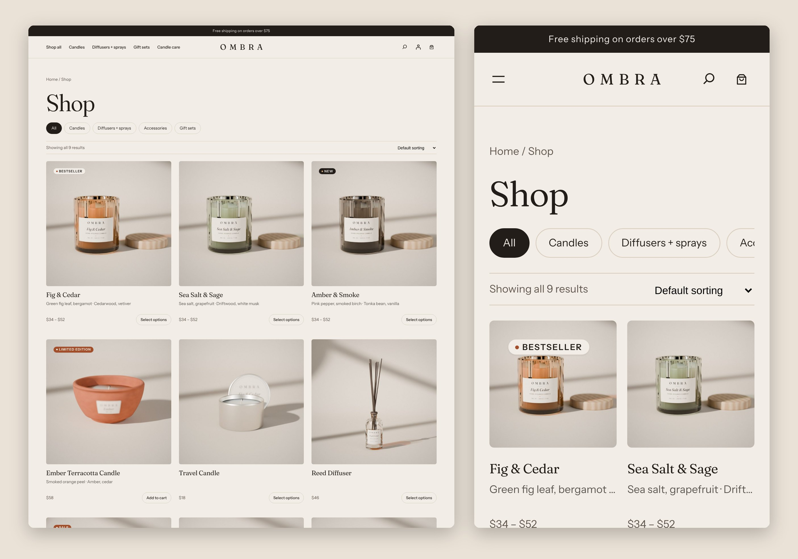
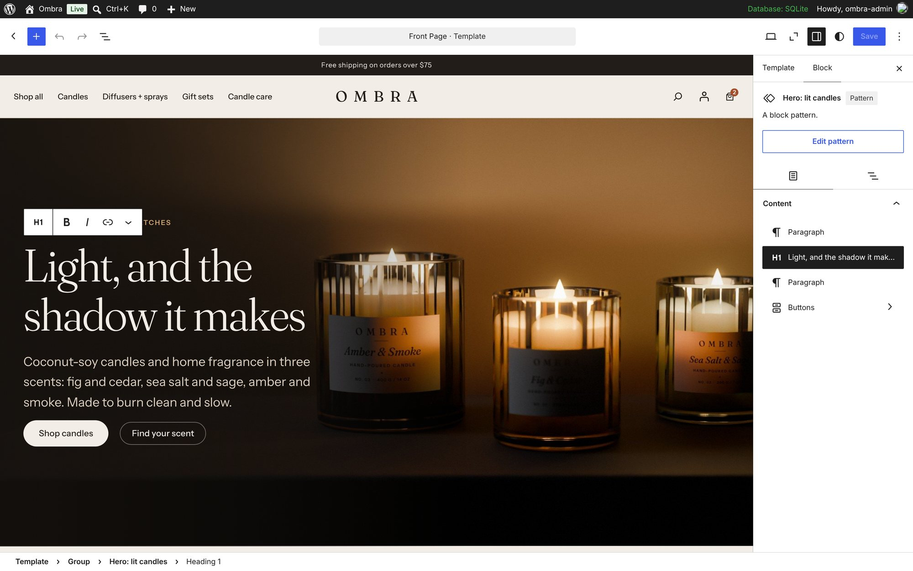
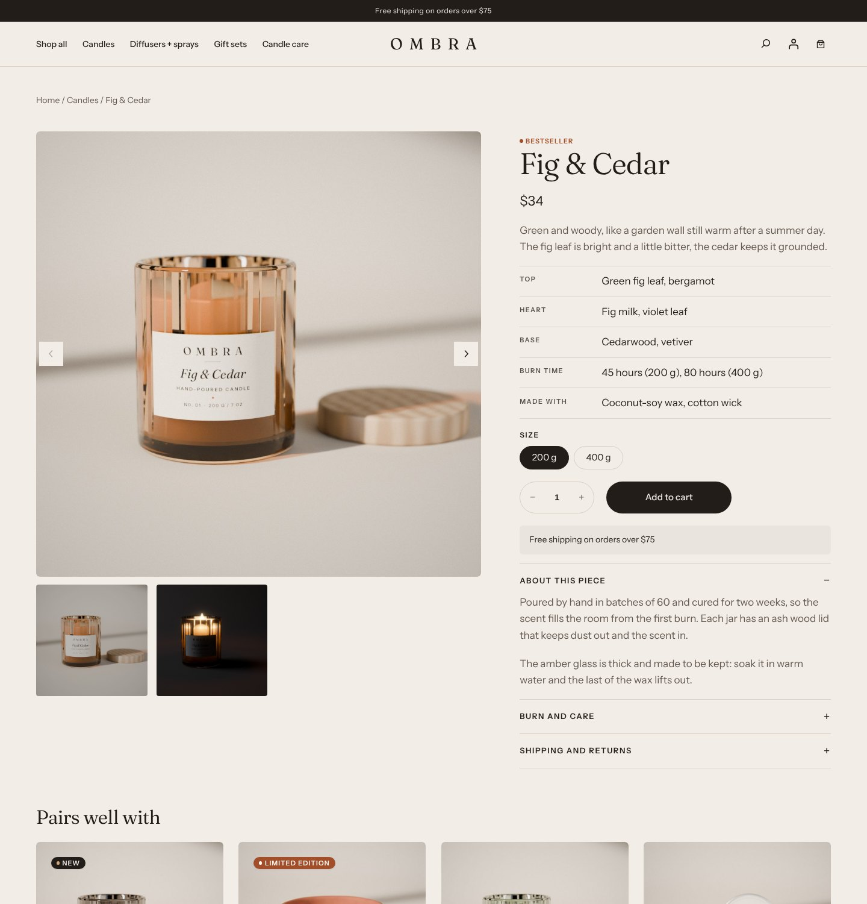

# WooCommerce store: block theme + store plugin

A complete WooCommerce store for **Ombra**, a made-up candle and home fragrance brand: a custom block theme (no page builder) and a small plugin with the store features clients ask for most. Built and tested on WordPress 7.1 and WooCommerce 11.2. Every product photo was modelled, lit and rendered in Blender for this demo.

**Live demo:** [open the store in WordPress Playground](https://playground.wordpress.net/?blueprint-url=https://raw.githubusercontent.com/bartnpu-droid/portfolio/main/08-woocommerce-store/playground/blueprint.json) (short link: [bartnpu-droid.github.io/portfolio/ombra](https://bartnpu-droid.github.io/portfolio/ombra/)). It runs in the browser, nothing to install: WordPress, WooCommerce, the theme, the plugin and the products are set up in about a minute. You are logged in as the store admin, so the settings, products and orders are one click away (bottom-right corner). Orders are not real and nothing is charged.

Demo video (53 s): [`ombra-woocommerce-demo.mp4`](ombra-woocommerce-demo.mp4)

## The plugin: Ombra Store Tools

`plugin/ombra-store-tools/`. Settings live in WooCommerce → Settings → Ombra.

### 1. Free shipping progress bar, everywhere and always in step

- In the Cart and Checkout blocks (slot fill), in the mini-cart drawer, in the announcement bar and on product pages.
- Updates after every cart change without reloading: adding from a product page, changing quantities in the mini-cart or the cart.
- One calculation on the server, added to the WooCommerce Store API cart response (`extensions`), so every place shows the same amount, counted the same way WooCommerce's Free shipping method counts it (after coupons).
- The goal comes from the store's own Free shipping method for the customer's shipping zone, or a fixed amount. Messages and bar colour are settings.
- Optional: once an order qualifies, checkout offers only free shipping (and local pickup), so nobody pays for shipping by mistake.

### 2. Gift options at checkout

- "This order is a gift" and a gift note in the Checkout block, through WooCommerce's Additional Checkout Fields API (no template overrides).
- The note field appears only when the box is ticked (conditional field rule), has a length limit with a clear error, and is saved with the order.
- WooCommerce shows it on the order confirmation, in emails and on the order screen; the plugin adds a "Gift" column to the orders list, with the note as a tooltip.

### 3. Product badges and scent notes

- An "Ombra details" tab in the product data box: badge (New, Bestseller, Limited edition, Back in stock), top, heart and base notes, burn time, materials. "Sale" shows by itself on discounted products.
- Two dynamic blocks for the Site Editor: the badge (over the product image or inline) and the scent notes (a list on the product page, one line on product cards). Both have a live preview in the editor.

## The theme: Ombra

`theme/ombra/`, a block theme: every colour, font and spacing value lives in `theme.json`, so the Site Editor can change them.

- Templates for the home page, shop and categories, product page, cart, a quieter checkout, pages and 404.
- WooCommerce blocks throughout: Product Collection grids, the Product Gallery, Add to Cart with Options (size and scent chips, the photo changes with the variation), the mini-cart drawer, Cart and Checkout blocks.
- Patterns for the home page sections (hero, categories, bestsellers, scents, story, candle care). Links are built from the site address, so the theme works on a sub-folder or a staging domain.
- Fraunces and Instrument Sans, self-hosted and trimmed to Latin: 260 KB for all four files.
- Phone layout: menu overlay, two-column product grid, chips that scroll sideways, no sideways scrolling anywhere.

Every section is a pattern in the Site Editor, so texts, images and colours can be changed without touching code:

The whole home page in one image: [`screenshots/store-home.jpg`](screenshots/store-home.jpg)

## Product photos

Rendered in Blender (Cycles) from a Python script (`tools/render/`): glass jars in three tints, a brushed tin, a terracotta bowl, a reed diffuser, a room spray, a jar of matches and a gift box, all with printed labels in the brand fonts, in one studio set with soft window light. The hero and the "lit" photos are night scenes lit only by the candle flames.

## Run it

- In the browser: the live demo link above (`playground/blueprint.json`).
- On any WordPress 6.7+ site with WooCommerce: copy `theme/ombra` to `wp-content/themes/` and `plugin/ombra-store-tools` to `wp-content/plugins/`, activate both. For the demo products, unzip `playground/ombra-images.zip` into `wp-content/ombra-setup/` and run `wp eval-file playground/setup.php`.

## Checked

- WordPress 7.1.4, WooCommerce 11.2.2, PHP 8.3: home, shop, categories, product pages on desktop and phone; add to cart; quantity changes in the mini-cart and the cart; checkout with a gift note; the order in the admin.
- 24 automated checks on real WooCommerce carts: the amount left, coupons, a custom goal, which shipping rates are offered, gift note rules, badges (`wp eval-file tests/run-tests.php`).
- Every template opens in the Site Editor with no invalid blocks; no JavaScript errors in the browser console; no sideways scrolling on a phone.
- All PHP passes `php -l`; the plugin uses only public WooCommerce APIs (Store API, blocks integration, Additional Checkout Fields).

Ombra, its products and texts are made up for this demo; there are no reviews or customers. WooCommerce and WordPress are not included here.
